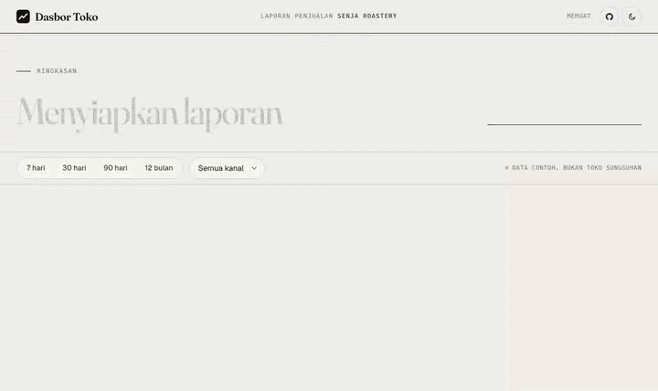
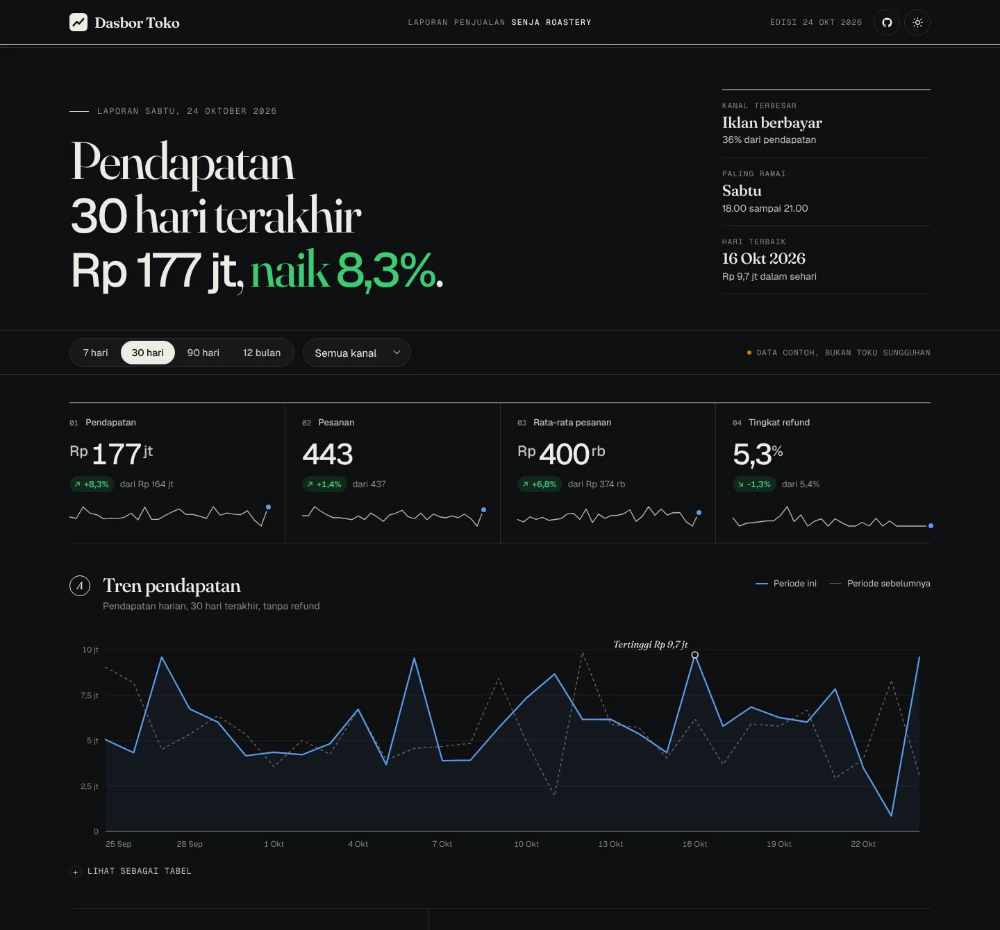
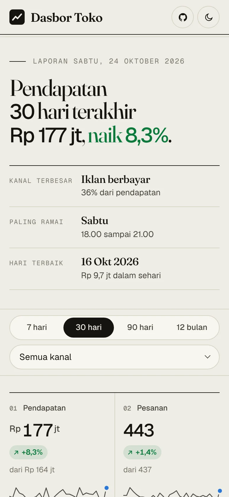
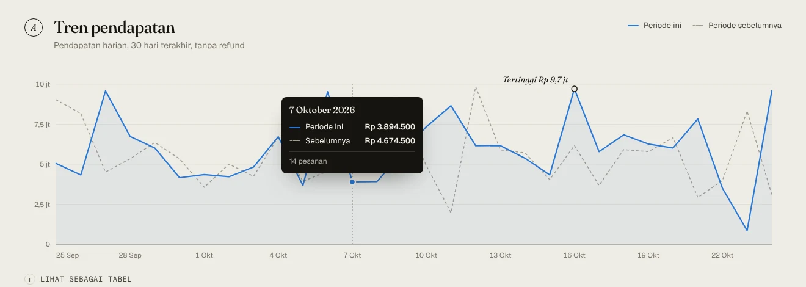

# Dasbor Toko

[](https://github.com/rezaaryam/dasbor-toko/actions/workflows/test.yml)


Dasbor penjualan toko yang dibaca seperti laporan harian. Kalimat pembukanya ditulis dari data, lalu angka, tren, dan buku pesanan menyusul di bawahnya. Semuanya JavaScript murni: tanpa framework, tanpa pustaka grafik, tanpa langkah build.

**[Buka demo](https://rezaaryam.github.io/dasbor-toko/)**



Tokonya, Senja Roastery, tidak ada. Dua tahun pesanan dibuat dari seed tetap, jadi demo selalu terlihat sama.

## Isi halaman

| Bagian | Gunanya |
|---|---|
| Kalimat pembuka | "Pendapatan 30 hari terakhir Rp 177 jt, naik 8,3%." Ditulis ulang setiap kali filter berubah, ditemani tiga catatan: kanal terbesar, jam paling ramai, dan hari terbaik. |
| Angka utama | Pendapatan, pesanan, rata-rata pesanan, dan tingkat refund, masing-masing dibandingkan dengan periode sebelumnya yang sama panjang. Untuk refund, turun dihitung kabar baik. |
| A. Tren pendapatan | Harian untuk 7 sampai 90 hari, mingguan untuk 12 bulan. Periode sebelumnya digambar putus-putus, titik tertinggi diberi catatan. Arahkan kursor atau ketuk untuk angka pastinya. |
| B. Kanal | Klik satu kanal untuk menyaring seluruh halaman. Warna kanal tetap sama di semua bagian, termasuk di tabel. |
| C. Jam tersibuk | Pesanan per hari dan blok tiga jam dalam satu skala warna. Sel tersibuk diberi bingkai. |
| D dan E. Kategori dan kota | Porsi pendapatan, angkanya tertulis langsung di setiap batang. |
| F. Buku pesanan | Cari, saring status, urutkan kolom, pindah halaman, dan unduh CSV persis sesuai yang disaring. |

Filter tersimpan di URL, jadi `?rentang=90&kanal=Email` membuka tampilan yang sama persis.

<table>
  <tr>
    <td width="64%"></td>
    <td></td>
  </tr>
</table>



## Menjalankan di komputer

Halaman memuat `data/orders.json` lewat `fetch`, jadi perlu server web. Membuka `index.html` dengan klik dua kali tidak akan jalan.

```bash
git clone https://github.com/rezaaryam/dasbor-toko.git
cd dasbor-toko
npm start                # membuka docs/ di http://localhost:3000
```

Tanpa Node, bisa juga: `cd docs` lalu `python -m http.server`.

## Susunan proyek

```
docs/                    situs (GitHub Pages menyajikan folder ini)
  index.html
  css/dasbor-toko.css    token warna terang dan gelap, tata letak, gerak
  js/metrics.js          fungsi murni: decode, filter, summarize, series, heatmap, insights
  js/charts.js           grafik garis SVG, batang, peta panas, sparkline, tooltip
  js/app.js              status, URL, kejadian, menggambar ulang
  data/orders.json       7.761 pesanan fiktif
  fonts/                 Fraunces, Geist, Geist Mono (SIL Open Font License)
scripts/generate-data.js pembuat orders.json dengan seed tetap
test/metrics.test.js     16 tes untuk lapisan angka
```

`metrics.js` tidak pernah menyentuh DOM. Angka bisa diuji di Node, dan grafik cukup menggambar apa yang diberikan.

## Memakai data sendiri

Ganti `docs/data/orders.json` dengan bentuk yang sama:

```json
{
  "end": "2026-10-24",
  "currency": "IDR",
  "refundStatus": "Dikembalikan",
  "dict": {
    "channels": ["Organik", "Iklan berbayar", "Media sosial", "Email"],
    "categories": ["Biji kopi", "Alat seduh"],
    "cities": ["Jakarta", "Bogor"],
    "statuses": ["Selesai", "Dikirim", "Menunggu", "Dikembalikan"]
  },
  "columns": ["id", "ts", "channel", "category", "city", "items", "total", "status"],
  "rows": [["SR-10000", "2026-10-24T13:05", 0, 1, 1, 2, 485000, 0]]
}
```

Setiap baris menyimpan nomor urut kamus, bukan teks berulang, jadi 7.700 pesanan cukup sekitar 85 KB setelah dikompres. `end` adalah hari terakhir data, dan semua rentang dihitung mundur dari sana.

## Keputusan desain

- **Dibaca seperti laporan, bukan panel kontrol.** Garis pemisah menggantikan kotak, judul bagian memakai huruf serif, dan halaman dibuka dengan satu kalimat yang menjawab "bagaimana penjualan kita?".
- **Satu sumbu per grafik.** Periode ini dan sebelumnya memakai skala yang sama, jadi perbandingannya jujur.
- **Warna punya satu tugas.** Kanal memakai urutan warna kategori yang sudah diuji untuk buta warna. Jumlah memakai satu warna dari terang ke gelap. Naik dan turun selalu disertai panah, tidak hanya warna.
- **Ringan di ponsel.** Tidak ada pustaka, huruf disimpan sendiri, tabel lebar bergeser di dalam kotaknya sendiri, dan animasi berhenti jika perangkat meminta gerak dikurangi.

## Pengembangan

```bash
npm test        # node --test, tanpa dependensi
npm run data    # membuat ulang docs/data/orders.json dari seed
```

Tes berjalan di Node 18, 20, dan 22 lewat GitHub Actions.

## Lisensi

Kode: MIT © Reza Arya Maulana. Huruf di `docs/fonts/` memakai SIL Open Font License, salinannya ada di folder itu.
